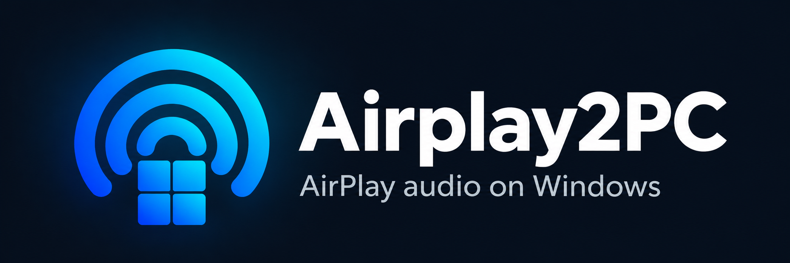

# Airplay2PC

An AirPlay 2 audio receiver for Windows, built on
[openairplay/airplay2-receiver](https://github.com/openairplay/airplay2-receiver)
with playback fixes and a Windows tray app.

I wanted to use my PC speakers alongside my other AirPlay speakers. Playback
is clean, volume works from the iPhone, and sync sounds spot on to my ear in
my setup. I've tested it with Spotify set to lossless streaming. I haven't
measured the alignment in milliseconds or checked long-run drift yet.

This repo contains the patches, launchers, tray app and tests.

## Run

Download the **Windows installer** from [Releases](https://github.com/mrk1987/Airplay2PC/releases/latest)
and run it on Windows x64. Setup needs an internet connection. It installs
for your account and downloads Python and the receiver. Opening the app starts
the receiver automatically. If Settings asks for a LAN interface, select your
physical network adapter and save.

The installer is unsigned, so Windows may show an unknown-publisher warning.
The release includes SHA-256 checksums. No administrator access is required.
If Windows asks about the firewall, allow Python on your private network.

The tray lets you start, stop and restart the receiver,
choose a network interface, set an output delay and enable startup at login.
See [Tray app](docs/tray-app.md) for details. For a source checkout, follow
[Setup](docs/setup.md), then run `.\packaging\Start-Tray.ps1`.

## Documentation

- [Setup and development](docs/setup.md): source setup and tests.
- [Project layout](docs/development.md): source folders and launch commands.
- [Playback repairs](docs/playback-fixes.md): measured bugs and fixes.
- [Multiroom design](docs/multiroom.md): timing limitations, choices and alternatives.
- [Validation](docs/validation.md): verified results, remaining tests and timing probe usage.
- [Timing development](docs/timing-development.md): experimental implementation and next steps.
- [Building a release](docs/release.md): installer, source package and uninstall.

## Licence

My original code is [MIT licensed](LICENSE). Use it, change it, share it.
The upstream receiver has no licence file and is downloaded separately during
setup. Third-party code, patch context and trademarks aren't covered by
my licence. See [Third-party notes](docs/THIRD_PARTY.md).

This is an independent project, not an Apple or Spotify product.
